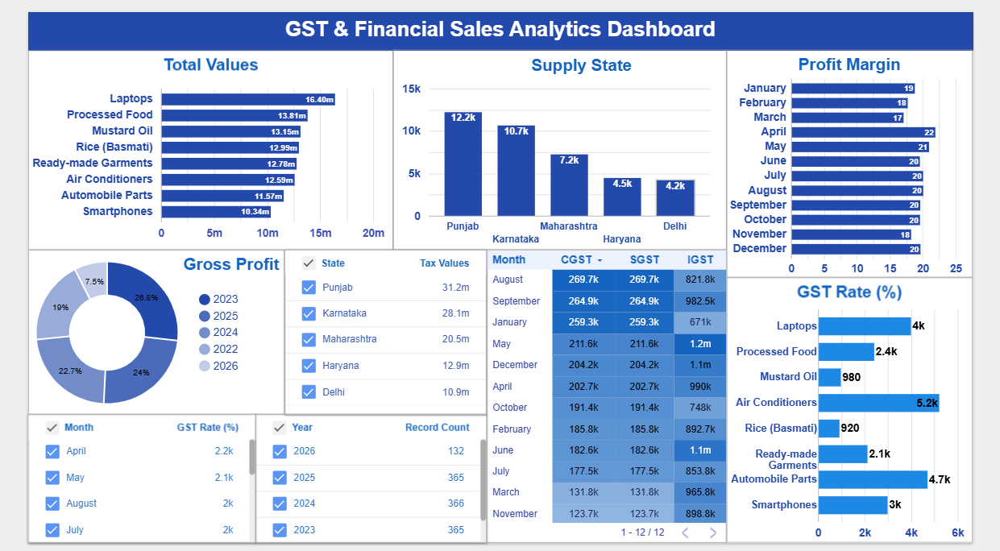

# Indian GST & Financial Sales Performance Dashboard
> **An Advanced Data Analytics & Financial Compliance Project in Microsoft Excel**

---

## 📸  Executive Dashboard Preview


---

## 📌 Project Overview
This project showcases a production-ready **Financial Sales Dashboard** built using a simulated dataset of **1,500+ transactional records**. The core objective is to analyze regional sales distribution across India while automatedly auditing **GST Compliance (CGST, SGST, IGST)** based on statutory tax slabs.

---

## 📌 Software & Tools 
- **Accounting Software:** Tally & Busy
- **Microsoft Excel:** Data analysis, power Query, Formule, Pivot Table & Dashboard.

---

## 🛠️ Tech Stack & Analytical Framework

| Phase | Framework / Feature Used | Key Actions Delivered |
| :--- | :--- | :--- |
| **Data Architecture** | Excel Tables & Custom Indexing | Standardized data tracking for 1.5k+ dynamic rows. |
| **Compliance Auditing**| Statutory HSN & GST Mapping | Structured exact 4-digit HSN codes and 15-character GSTINs. |
| **Data Engineering** | Advanced Logical Formulas | Built robust fiscal timelines and Place of Supply (POS) rules. |
| **BI Visualization**  | Pivot Charts & Interactive Slicers | Designed synchronized KPI drill-downs for seamless auditing. |

---

## 🧮 Core Formula Engineering

To accurately mirror Indian accounting standards, the backend database utilizes these key calculated fields:

1. **Indian Financial Year (April - March Cycle):**
   ```excel
   =IF(MONTH(Invoice_Date)>=4, YEAR(Invoice_Date) & "-" & YEAR(Invoice_Date)+1, YEAR(Invoice_Date)-1 & "-" & YEAR(Invoice_Date))
   ```
2. **Tax Jurisdictional Split (Place of Supply Logic):**
   * Automatically segments revenue streams into **Intrastate** (splits tax into 50% CGST + 50% SGST) or **Interstate** (100% IGST allocation) depending on trade boundaries.

---

## 📊 Business Insights Extracted
* **Geographical Sales Density:** The *Supply State* combo-chart identifies Punjab as a leading market with maximum intrastate volume, contrasted against critical interstate operations in Karnataka and Maharashtra.
* **Tax Bracket Velocity:** The *GST %* doughnut distribution identifies which standard tax brackets (5%, 12%, 18%, 28%) are driving maximum high-ticket consumer electronics or retail items.
* **Temporal Volatility:** Features a month-over-month trend breakdown mapping collective cash inflows across separate tax streams.

---

## 🚀 Interactive Features
* **Timeline Filter:** Click on years or quarters to watch the entire dashboard recalculate instantly.
* **State Slicer:** Filter by specific business regions to drill down into localized tax obligations.

---
---

## 🤝 Contact & Connect
If you have any questions about this project or would like to collaborate on data analytics initiatives, feel free to reach out!

- **👤 Name:** Manpreet Singh
- **📧 Gmail:** preetaulakh8756@gmail.com
- **🖥️ GitHub Profile:** [Preet-Aulakh](https://github.com)
  


